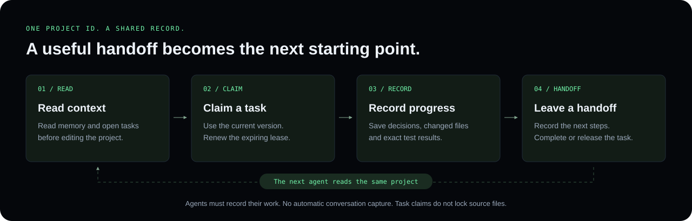
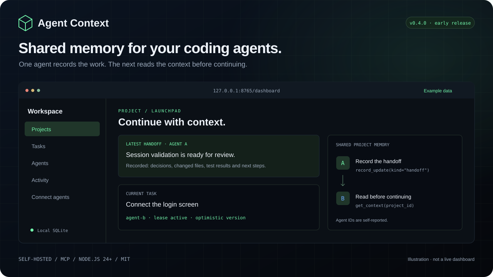

<h1>&nbsp; Agent Context</h1>

Shared project memory and task handoffs for MCP-compatible coding agents.
One agent records the work; the next reads the context before continuing.
Run it on your computer or a team server, with a React dashboard and local
SQLite storage.

[Website](https://agentcontext.suyashb.me) · [npm](https://www.npmjs.com/package/@suyashb/agent-context) · [Documentation](docs/README.md) · [GitHub](https://github.com/suyashB45/agent-context) · [Contributing](CONTRIBUTING.md)

**Early release: 0.4.0 · Node.js 24+ and npm · MIT license**


[](https://nodejs.org/)
[](https://react.dev/)
[](https://sqlite.org/)
[](https://nextjs.org/)
[](https://tailwindcss.com/)
[](https://www.npmjs.com/package/@suyashb/agent-context)

The published package is **`@suyashb/agent-context`**. The executable is
**`agent-context`**. No Python, cloud model or model API key is required by the
server; your coding agent may have its own requirements.

<a id="install-from-npm"></a>

## Get started

Install from the [public npm package](https://www.npmjs.com/package/@suyashb/agent-context)
and start the service:

```bash
npm install -g @suyashb/agent-context
agent-context
```

Keep that terminal open. In a second terminal, retrieve the access token:

```bash
agent-context token
```

Open **http://127.0.0.1:8765/dashboard**, paste the token, create a project and
open **Connect agents**. The token stays in page memory, so enter it again after
reloading. Stop the service with Ctrl+C.

To pin the current release, install `@suyashb/agent-context@0.4.0`.
The unscoped package `agent-context-mcp` belongs to another maintainer.

<a id="quick-start-downloaded-npm-package"></a>

### Install a downloaded package

Download `suyashb-agent-context-0.4.0.tgz` from the
[official website](https://agentcontext.suyashb.me). From the folder containing
that file:

```bash
npm install -g ./suyashb-agent-context-0.4.0.tgz
agent-context
```

Then retrieve the token and open the dashboard as above. An `ENOENT` error means
npm cannot find the archive at the path supplied.

<a id="quick-start-source-checkout"></a>

### Run from source

From the repository root:

```bash
npm ci
npm run build:runtime
npm start -- --db ./data/dev.sqlite3
```

In a second terminal, from the same directory:

```bash
node bin/agent-context.mjs token --db ./data/dev.sqlite3
```

This builds the MCP service and local React dashboard without a global install.
To create an installable archive from your checkout:

```bash
npm pack --ignore-scripts --pack-destination dist/npm
npm install -g ./dist/npm/suyashb-agent-context-0.4.0.tgz
```

A locally packed archive can contain changes beyond the published release.
Website downloads preserve the exact published npm archive; changing the
repository does not replace version 0.4.0 on npm.

<a id="connect-coding-agents"></a>

## Connect your agents

Use an MCP-compatible host over **stdio** or **Streamable HTTP**. Configuration
examples cover Claude Code, Codex, Cursor, VS Code/Copilot, Gemini CLI and generic
MCP clients. This does not mean every client version has been tested.

For agents on the same computer, generate settings with the same absolute
database path used by your dashboard:

```bash
agent-context config --client generic --db /absolute/path/to/shared/context.sqlite3
```

Use `--client cursor`, `--client vscode` or `--client gemini` for those wrappers.
Merge the generated entry into existing settings; the command does not edit
files. Enable the tools and start a fresh agent session. See
[client setup](docs/clients.md) for client-specific instructions.

Each stdio client starts its own `agent-context stdio` process against the same
local database. It does not need an HTTP token or a separate dashboard process.
Remote clients connect to the shared host’s `/mcp` endpoint with its token.

<a id="make-handoffs-part-of-the-workflow"></a>

## Leave a useful handoff



Use the same project ID across agents and a unique agent ID per session. Add
[these instructions](examples/AGENT_INSTRUCTIONS.md) to the instruction file
your client reads, preserving its existing content:

```text
Use agent-context MCP for project ID "my-project".
Use a unique agent_id per session.
Read get_context and list_tasks before editing; create the project if needed.
Claim a task and renew its lease before expiry.
Record progress, decisions, changed files, and exact test results.
Before stopping, record a handoff and complete or release the task.
```

Check the connection by asking one agent to record a test handoff and another
to read it from the same project. Agents must inspect the repository and write
their findings. The server does not capture conversations or scan code
automatically. A useful record includes what changed, what was verified and
what the next agent should do.

<a id="what-it-provides"></a>

## What it stores

- Persistent project context, decisions, test reports and handoffs.
- Task claims with expiring leases, optimistic versions and safe retry IDs.
- Paginated history with literal search.
- Project, task, agent and activity records visible in the React dashboard.
- Consistent backups and database integrity checks.



*Product illustration with example data. This is not a screenshot of a live
instance or the public website.*

<a id="connect-your-team"></a>

## Work with your team

Run one shared server with a database on its local disk. Teammates keep their
own agents and models and connect using Streamable HTTP.

| Connection | Suitable for |
| --- | --- |
| Same Wi-Fi / LAN | One private office or home network |
| Private VPN | Teammates in different locations |
| SSH tunnel | A host the team can already reach over SSH |
| HTTPS server | An always-on team service |

The [team guide](docs/team.md) covers commands, allowlists, firewall settings
and token setup. Plain LAN HTTP is unencrypted; use a VPN, SSH tunnel or HTTPS
for routine access. Keep SQLite on a local disk, never on a network drive.
Teammates use the shared host’s token rather than a token from their own server.

## Current limits

Every token holder can read and write every project in an instance. Agent IDs
are self-reported, and task claims do not lock source files. There are no
individual accounts, OAuth, project permissions or automatic conversation
capture. Use separate instances for unrelated trust groups.

Read [SECURITY.md](SECURITY.md) before exposing a shared instance. Local models
also need reliable tool calling and an MCP-capable host; see
[compatibility](docs/compatibility.md).

## Documentation

| Task | Guide |
| --- | --- |
| Find a starting point | [Documentation index](docs/README.md) |
| Connect an editor or agent | [Client setup](docs/clients.md) |
| Check systems and local models | [Compatibility](docs/compatibility.md) |
| Connect teammates | [Team connections](docs/team.md) |
| Configure, containerize, back up or upgrade | [Operations](docs/operations.md) |
| Look up commands and MCP tools | [Reference](docs/reference.md) |
| Fix installation or connection errors | [Troubleshooting](docs/troubleshooting.md) |
| Understand the implementation | [Architecture](docs/architecture.md) |
| Work on the product website | [Website development](docs/website.md) |
| Publish a release or deploy | [Maintainer guide](docs/release.md) |

<a id="website-and-local-application"></a>

## Public website and local service

**https://agentcontext.suyashb.me** hosts the product website, documentation and
downloads. Users run the MCP service and dashboard locally or on a team server.
Vercel hosts the public website; it does not run the persistent SQLite service.

The website uses Next.js App Router, Tailwind CSS and Framer Motion. Landing
copy, the example handoff and roadmap items live in `site/src/content.js`;
`app/identity.css` defines its restrained dark/light design. See
[website development](docs/website.md) for contributor preview instructions.

| Build | Purpose |
| --- | --- |
| `npm run build:runtime` | Bundle the MCP service and local React dashboard into `build/npm/` |
| `npm run build` | Build release artifacts and the public website; check docs, pages and downloads |

For Vercel, import the repository root (`./`), use the **Next.js** preset,
**Node.js 24.x**, build command **`npm run build`**, and Output Directory
**`.next`**, as configured in `vercel.json`. The Next.js adapter reads its
manifests from `.next/`; `out/` remains the static export used for local checks.
Setting Vercel’s Output Directory to `out` causes `NEXT_NO_ROUTES_MANIFEST`.

Repository and website updates do not change the already published npm package.
A new package release requires a new version. Check the intended commit’s CI,
live downloads and npm publication using the [release guide](docs/release.md)
before announcing a launch.

<a id="contribute-and-get-help"></a>

## Contribute or get help

Use [GitHub issues](https://github.com/suyashB45/agent-context/issues) for
reproducible bugs and feature proposals. Read [CONTRIBUTING.md](CONTRIBUTING.md),
[community expectations](CODE_OF_CONDUCT.md) and the [roadmap](ROADMAP.md).
Report vulnerabilities privately through [SECURITY.md](SECURITY.md).

The earlier Python prototype is historical. Its `agent-context-mcp` executable
is distinct from this release’s `agent-context`. Keep an explicit `--db` when
migrating an existing database; see the
[legacy guide](https://github.com/suyashB45/agent-context/blob/main/docs/legacy-python.md).

[MIT license](LICENSE) · Maintained by [Suyash Balasubramaniam](https://suyashb.me)
