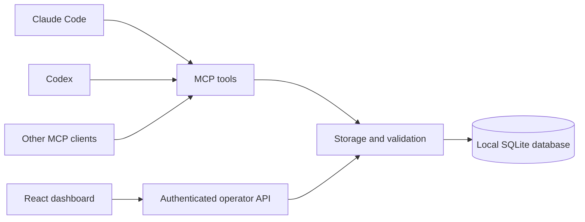

# Architecture

The Node service exposes a React dashboard, an authenticated operator API, and
MCP transports over stdio and Streamable HTTP. They use the same SQLite schema.

`src/store.mjs` owns project records, events, task leases, optimistic revisions,
retry IDs, and backups. Write transactions use `BEGIN IMMEDIATE`, so independent
agent processes contend for claims atomically. WAL mode and full synchronous
writes support local durable storage. The database schema remains compatible
with the earlier Python implementation.

`src/mcp.mjs` registers tools, the project-context resource, and the resume
prompt using the official MCP SDK. It serves old and new supported protocol
eras through the SDK; application tools remain transport-independent.

`src/http.mjs` validates credentials and Host/Origin headers before exposing
operator APIs and MCP. It bounds protected requests and body sizes, and serves
only the known public dashboard assets. Health and readiness are distinct.
The native Node adapter handles HTTP streams without a separate framework.

`web/src/` contains the React application. Its token exists only in page memory.
Stored content is rendered as text. A compiled browser build ships inside the
npm package, so consumers do not need the build dependencies.

`scripts/build.mjs` bundles the Node service and React assets. It checks for
unexpected external runtime imports and includes third-party license files.
The npm package has no external runtime npm dependencies; Node provides SQLite.

Each instance is one trust boundary. Every bearer token holder has the same
read/write permissions. Agent names are client reports, not authenticated
identities. The server does not capture conversations, inspect source code,
execute tests, run agents, or make model API calls.

## Configuration and product website

`src/client-config.mjs` generates model-independent stdio settings with the
client-specific JSON wrapper. The CLI prints it without editing files. The
running dashboard gets its database path through the authenticated
`/api/connection` endpoint; copied local configs are for that host computer.

`app/` contains the product website’s Next.js App Router routes, metadata,
sitemap and global Tailwind stylesheet. `site/src/sections/` has one React
component per landing section; `site/src/content.js` centralizes landing copy
and editable roadmap items. Framer Motion handles reduced-motion-aware
transitions. The static export in `out/` includes the docs and verified
npm/source archives. See [website development](website.md). It
contains no MCP instance database or credentials. `vercel.json` deploys that
static output. See [operations](operations.md), [reference](reference.md), and
[team networking](team.md) for runtime setup.
